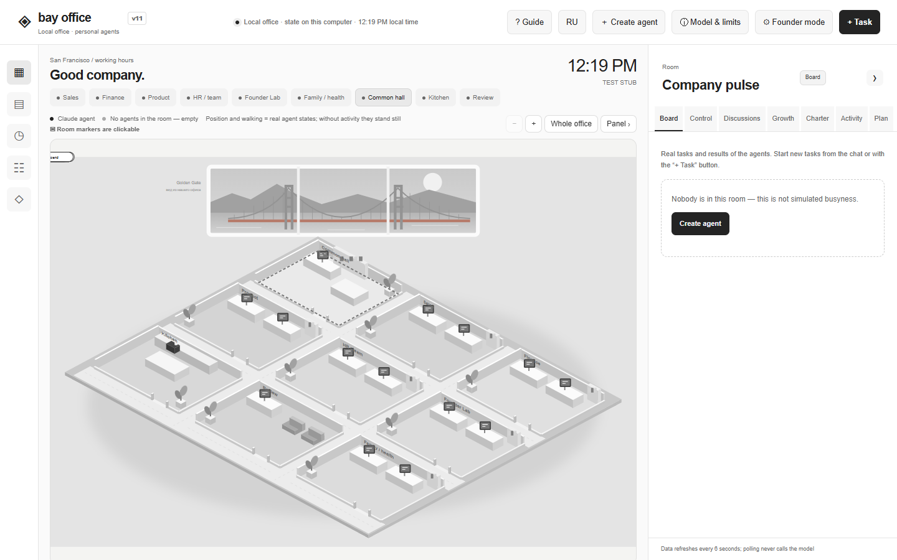

# Bay Office — portable alpha 0.2.1

A visual local office for AI employees: you chat with an employee, give feedback, correct its rule, review two real cases, then explicitly allow bounded repeats. It runs on your own computer; inference goes through **your own** Claude Code sign-in. **Alpha for a small manual pilot. Not a hosted service, not a finished product.**

*Screenshots are from a synthetic example with a stub provider ("TEST STUB"), not real model output.*

## Quickstart (Windows — the only tested platform)
1. Install **Node.js 20+ (LTS)** from https://nodejs.org/ .
2. Install official **Claude Code** per https://code.claude.com/docs/en/overview and sign in with **your own** account via its native flow (run `claude` once).
3. Unzip into a normal folder (no admin rights), double-click **START.cmd**. The browser opens with a private link; the app listens on `127.0.0.1:8194` only.
4. Double-click **CHECK.cmd** to see whether Node / Claude Code / sign-in are OK (not a model request).
5. In the office: *Create agent* → **Project Notes Reporter** (or custom) → add/import `.md`/`.txt` notes → send a task → answer clarifications → edit the rule → review a second, different case → explicitly permit bounded repeats.
6. **STOP.cmd** stops this copy and its own Claude child process. Data stays in `./data`.

Default language is English; the **RU** button switches to Russian and persists. Another port: set `BAY_PORT`. Another data folder: `BAY_DATA_DIR`.
macOS/Linux: `npm start` may work but is **experimental and unverified**.

## What it does / does not
- Does: local state in `./data`; agent tasks via the unmodified Claude Code CLI with tools disabled, bounded time, and a durable finite allowance (20 requests, max 3 scheduled repeats — an app cap, **not** your Claude quota); mechanical checks; a manual local milestone export (JSON/CSV without task text/names/paths).
- Rules you edit are instructions/examples given to the model, **not model-weight learning**. Two reviewed cases permit narrow drafts; they are not a competence score.
- Does not: sign you in, collect credentials, call a model when a page opens/polls/checks login, fall back to a paid API, send telemetry, or run schedules when your PC is off.
- Auth method this alpha targets: Claude Code with a claude.ai sign-in. Other providers are not claimed.

## Known limitations
Windows only tested. On 21 November 2026, the 0.2.1 ZIP completed an automated UI acceptance run with four real Haiku calls: task, feedback, a second distinct case, and one scheduled draft using updated notes. The reviewer was an agent, not a person. **No human usability study has been conducted.** The office scene is unchanged from the owner edition. Asset generator terms are unverified (see NOTICE.md). Schedules are finite and need the PC on.

## Tests
`npm test` (stubs only, no model calls). Browser tests: set `PLAYWRIGHT_PATH` to an installed playwright module, then `npm run test:browser` (Playwright is a devDependency, not bundled).

## Docs
[AUTH-AND-PRIVACY](AUTH-AND-PRIVACY.md) · [Troubleshooting](TROUBLESHOOTING.md) · [Pilot protocol](PILOT-PROTOCOL.md) · [Results template](pilot-results-template.csv) · [NOTICE](NOTICE.md) · MIT [LICENSE](LICENSE)

---

# Bay Office — портативная альфа 0.2.1 (RU)

Визуальный локальный офис AI-сотрудников: чат → обратная связь → правка правила → два разных реальных кейса → явное разрешение ограниченных повторов. Работает на вашем компьютере; запросы идут через **ваш собственный** Claude Code. **Альфа для небольшого ручного пилота, не облачный сервис.**

## Быстрый старт (Windows — единственная проверенная платформа)
1. Установите **Node.js 20+ (LTS)**: https://nodejs.org/
2. Установите официальный **Claude Code** (https://code.claude.com/docs/en/overview) и войдите **своим** аккаунтом штатным способом (запустите `claude` один раз).
3. Распакуйте ZIP в обычную папку, дважды щёлкните **START.cmd**. Откроется браузер с приватной ссылкой; слушает только `127.0.0.1:8194`.
4. **CHECK.cmd** — проверка Node / Claude Code / входа (запрос к модели не отправляется).
5. Создать сотрудника → «Project Notes Reporter» или свой → добавить/импортировать заметки `.md`/`.txt` → задача → уточнения → правка правила → второй, другой кейс → явно разрешить ограниченные повторы.
6. **STOP.cmd** останавливает эту копию и её дочерний процесс Claude. Данные остаются в `./data`.

Язык по умолчанию — английский; кнопка **RU** переключает и запоминает. Порт: `BAY_PORT`, папка данных: `BAY_DATA_DIR`. macOS/Linux — экспериментально, не проверено.

## Честные границы
Правила — инструкции/примеры для модели, а не обучение весов. Два кейса разрешают узкие черновики, это не оценка компетентности. Лимит альфы (20 запросов, до 3 повторов) — лимит приложения, не квота Claude. Расписание работает только при включённом ПК. 21 ноября 2026 из ZIP версии 0.2.1 пройден реальный цикл через интерфейс: задача, обратная связь, второй кейс и плановый повтор с обновлённой заметкой; четыре обращения к Haiku. Проверял автоматический агент. Исследования с людьми ещё не было.
